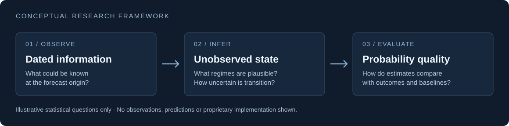

<strong>NORVUN / INTELLIGENCE INFRASTRUCTURE</strong>

# Intelligence for a world that doesn't stand still.

**The financial world is interconnected. The systems used to understand it often aren't.**

Norvun is building an integrated intelligence ecosystem across financial statements, economic relationships, capital flows, and investment research.

<table>
  <tr>
    <td width="33%" valign="top"><strong>Financial Intelligence</strong> Understand companies  Financial statements and traceable evidence.</td>
    <td width="33%" valign="top"><strong>Economic Intelligence</strong> Understand economies  Economic relationships and changing conditions.</td>
    <td width="33%" valign="top"><strong>Capital Flow Intelligence</strong> Understand ownership  Capital positions and changes through time.</td>
  </tr>
</table>

### Statistical inference

## [Estimating the unobservable. →](STATISTICAL_INFERENCE.md)

Can an unobserved economic regime be inferred from the information available at a particular point in time?

The research presented here represents a selected application of statistical inference within Norvun's Economic Intelligence product — one component of a broader intelligence ecosystem spanning corporate fundamentals, global economic relationships, capital movements and investment research.

This showcase examines a single research problem: the probabilistic estimation of economic states and their evolution over time.

Norvun's U.S. business-cycle research examines latent-state inference, regime transitions and duration uncertainty, with retrospective point-in-time evaluation and competing benchmarks.

**Research focus:** Conditional probability · Statistical estimation · Stochastic processes · Time-series validation · Probability scoring

[Explore the mathematics and research design →](STATISTICAL_INFERENCE.md)

### Explore the work

[**Architecture & Research**](ARCHITECTURE.md) — The intelligence ecosystem and its engineering principles.

[**Research standards & limitations**](EVIDENCE.md) — The statistical and engineering principles behind our research.

---

**[norvun.world](https://norvun.world)** · [Disclosure & usage](NOTICE.md)

Selected public research and architecture. Norvun’s models, forecasts, investment strategies and underlying data remain private.
