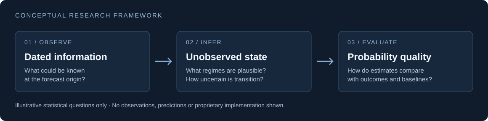

**NORVUN / STATISTICAL INFERENCE**

# Estimating the unobservable.

[← Norvun overview](README.md) · [Research standards](EVIDENCE.md)

**How can an economy's unobserved state be inferred from incomplete, temporally dependent evidence?**

The research presented here represents a selected application of statistical inference within Norvun's Economic Intelligence product — one component of a broader intelligence ecosystem spanning corporate fundamentals, global economic relationships, capital movements and investment research.

This showcase examines a single research problem: the probabilistic estimation of economic states and their evolution over time.

Norvun's U.S. business-cycle research examines this question through competing statistical approaches, historical release vintages and retrospective evaluation. The research separates state estimation, transition uncertainty and the assessment of predictive probabilities.

## Four mathematical questions

The research extends fundamental principles of probability, stochastic variables and statistical estimation to four mathematical questions. Norvun’s fitted models and implementation remain private.

**01 · Conditional probability — latent-state inference**

$$P(S_t=s\mid\mathcal I_t)$$

Given information available at time $t$, estimate the probability of an unobserved economic state $S_t$. The state is represented as a discrete stochastic variable; its conditional probability distribution assigns a probability to each possible state.

**02 · Conditional probability distributions — regime transitions**

$$P(S_{t+h}=j\mid\mathcal I_t)$$

The future economic state is a stochastic variable. Its conditional distribution describes the probabilities of possible states at a given horizon. An endpoint state probability is not the same as the probability of leaving the current regime at least once within the horizon.

**03 · Probability distributions — survival and duration analysis**

$$P(T>h\mid\mathcal I_t)=\prod_{k=1}^{h}(1-\lambda_k)$$

For a discrete residual lifetime $T$, $\lambda_k$ is the conditional probability of exit in period $k$, given survival to that period and the information set. This survival probability describes the distribution of remaining duration, from which an expected duration can be derived when finite. Duration estimates depend on assumptions about the conditional exit probabilities (hazards).

**04 · Squared prediction errors — probability evaluation**

$$\mathrm{BS}=\frac{1}{n}\sum_{i=1}^{n}(p_i-y_i)^2$$

For a binary outcome $y_i$, the Brier score evaluates probability predictions $p_i$ by squared loss. As a mean squared prediction error for a binary outcome, it evaluates probabilistic predictions rather than the variance of a parameter estimator. Interpretation requires comparison with appropriate baselines, calibration and discrimination metrics, and the intended economic use.

## The scientific question behind model selection

Does additional model complexity improve probability estimation, or does it introduce unnecessary estimation risk? The bias–variance trade-off provides a statistical lens for this question: greater flexibility may reduce some forms of systematic error but increase estimation variability. The research compares statistical approaches rather than presuming a more complex model is better. Probability scores and turning-point detection address different objectives.

**Validation matters as much as estimation.** Dated information sets, release-aware reference labels and retrospective out-of-sample evaluation address look-ahead risk. Serial dependence means successive observations cannot generally be treated as independent and identically distributed (iid). Overlapping horizons, limited independent recession episodes and model-selection effects constrain interpretation. Software tests and statistical performance are separate forms of evidence.

This research overview presents selected mathematical frameworks and validation principles. Detailed evaluation results, model specifications and current regime estimates remain proprietary.

[Research standards and limitations](EVIDENCE.md) · [Disclosure](NOTICE.md)
